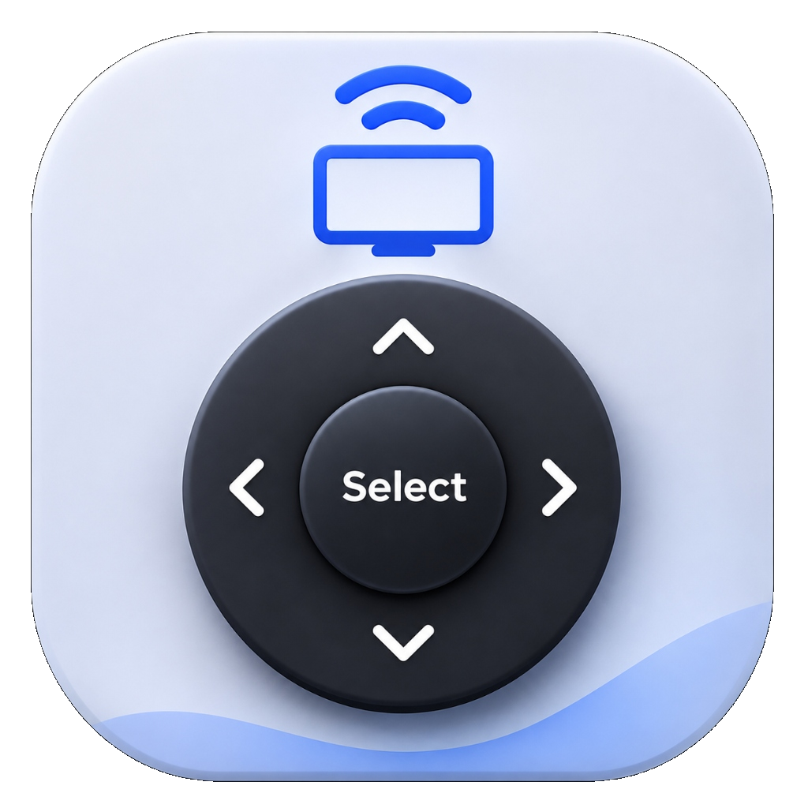
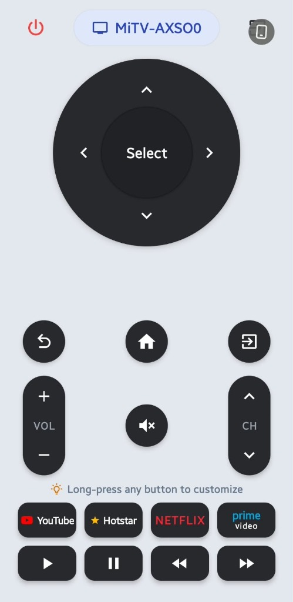
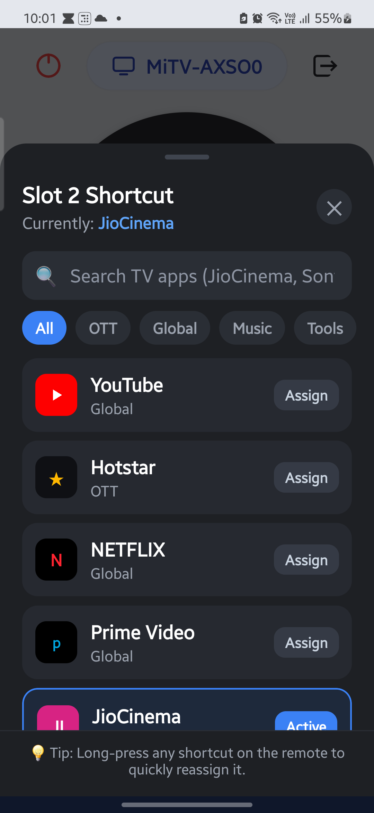
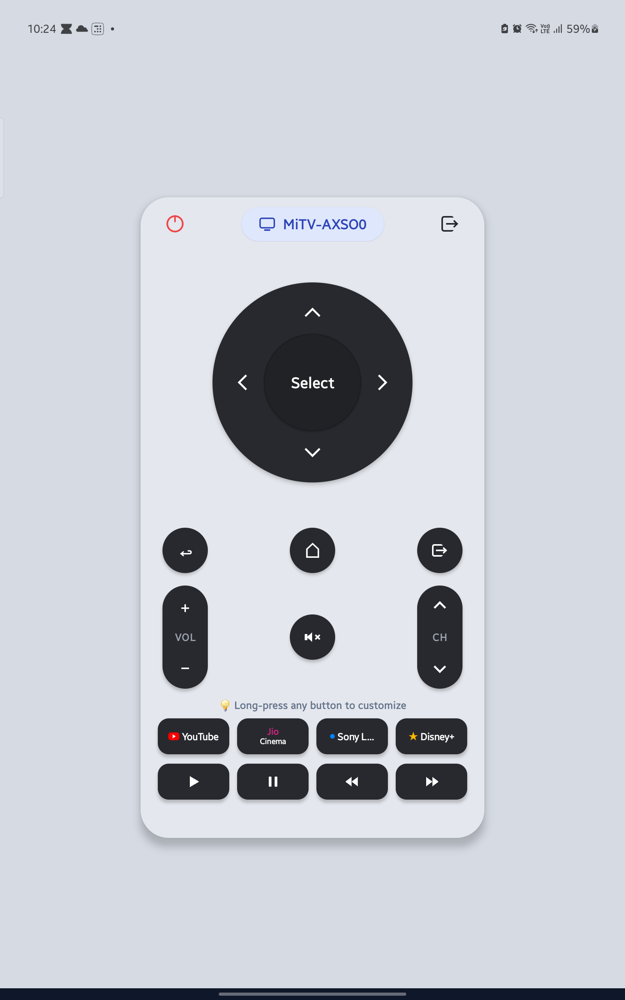

<div align="center">
  
  <h1>SmartTV Remote</h1>
  <p><b>A sleek, zero-latency, local-network open-source remote control for Android TV and Google TV.</b></p>

  <p>
    <a href="https://github.com/NaveenMohanty/SmartTV-Remote/releases/latest">
      
    </a>
    <a href="https://github.com/NaveenMohanty/SmartTV-Remote/releases">
      
    </a>
    <a href="LICENSE">
      
    </a>
  </p>

  <p>
    <a href="#-download">Download</a> •
    <a href="#-features">Features</a> •
    <a href="#-screenshots">Screenshots</a> •
    <a href="#-architecture">Architecture</a> •
    <a href="#-getting-started">Getting Started</a> •
    <a href="#-building-the-apk">Building APK</a> •
    <a href="CONTRIBUTING.md">Contributing</a> •
    <a href="LICENSE">License</a>
  </p>
</div>

---

## 📥 Download

You can download the latest pre-compiled APK directly to your phone without building from source:

| Source | Link | Compatibility |
| :--- | :--- | :--- |
| **GitHub Releases** *(Recommended)* | [**Download Latest APK (`.apk`)**](https://github.com/NaveenMohanty/SmartTV-Remote/releases/latest) | Android 8.0+ (Oreo to Android 15) |
| **Build from Source** | [Building the APK](#-building-the-apk) | Node.js 18+ & Java 17 |
| **F-Droid** | *Coming Soon* | Official Open-Source Repository |

### 📲 Quick Install Guide:
1. Tap the **[Download Latest APK](https://github.com/NaveenMohanty/SmartTV-Remote/releases/latest)** link on your Android phone.
2. Under the latest release assets, download `SmartTV-Remote-v1.0.0.apk` (or `app-release.apk`).
3. Tap the downloaded file in your browser or **Files** app.
4. If prompted with *"For your security, your phone is not allowed to install unknown apps from this source"*, tap **Settings** and toggle **Allow from this source**.
5. Tap **Install** and open **SmartTV Remote**!
6. Ensure your phone and Android TV / Google TV are on the **same Wi-Fi network**, tap the TV name (or enter IP manually), and enter the 4 or 6-character PIN displayed on your TV screen.

---

## 📸 Screenshots

<p align="center">
  
  &nbsp;&nbsp;&nbsp;&nbsp;
  
  &nbsp;&nbsp;&nbsp;&nbsp;
  
</p>

---

## ✨ Features

- **🔒 100% Local Network (No Cloud)**: Communicates directly with your TV over local Wi-Fi via TLS 1.3 encryption and Google's Polo pairing protocol. No third-party accounts, no tracking, and no ads.
- **⚡ Zero-Latency Control**: 0ms delay on button taps with instant single-thread command queueing.
- **🔄 Long-Press Continuous Repeating**: Just like a physical remote, hold down navigation arrows, volume, or channel rockers to smoothly repeat commands with tactile haptic feedback.
- **🚀 Customizable App Shortcuts**: 4 customizable shortcut slots with curated streaming app launchers (YouTube, Hotstar, Netflix, Prime Video, JioCinema, Spotify) or launch any installed Android TV package.
- **📱 Responsive UI**: Scales cleanly across all phone screen sizes, foldables, and tablets.
- **🎨 Vector Crisp Icons**: Uses official Material Community Icons for razor-sharp rendering on all display densities.
- **🔍 Auto-Discovery**: Finds Android TV and Google TV devices automatically on your Wi-Fi network using mDNS (`_androidtvremote2._tcp`), with manual IP fallback.
- **⏰ Wake-on-LAN (WoL)**: Powers on sleeping TVs over the local network using magic packets.

---

## 🛠️ Architecture

```
┌────────────────────────────────────────────────────────┐
│             React Native (TypeScript UI)               │
│  - DPad with Continuous Repeating (useRepeatingKey)    │
│  - ControlsCluster (Volume, Channels, Media, Hints)    │
│  - ShortcutPickerModal & DevicePickerModal             │
└───────────────────────────┬────────────────────────────┘
                            │ (React Native Bridge)
┌───────────────────────────▼────────────────────────────┐
│          Android Native Module (Kotlin)                │
│  - AndroidTvRemoteModule (Single-thread Command Queue) │
│  - PoloProtocol (Polo Pairing & Remote v2 Protocol)    │
│  - SslHelper (BouncyCastle TLS Cert & SSL Context)   │
│  - NsdManager (mDNS _androidtvremote2._tcp Discovery)  │
└───────────────────────────┬────────────────────────────┘
                            │ (TLS Encrypted TCP Sockets)
┌───────────────────────────▼────────────────────────────┐
│      Android TV / Google TV (Ports 6466 & 6467)        │
└────────────────────────────────────────────────────────┘
```

---

## 🚀 Getting Started

### Prerequisites
- **Node.js**: `18.x` or higher
- **JDK**: Java 17 (`openjdk-17-jdk`)
- **Android SDK**: API level 34 (`Android 14`) with command-line tools and platform-tools (`adb`)

### Installation

1. **Clone the repository**:
   ```bash
   git clone https://github.com/NaveenMohanty/SmartTV-Remote.git
   cd SmartTV-Remote
   ```

2. **Install dependencies**:
   ```bash
   npm install
   ```

3. **Run on connected Android device / emulator**:
   ```bash
   npm run android
   ```

---

## 📦 Building the APK

### Optimized Release APK
```bash
npm run build:release
```
Output: `android/app/build/outputs/apk/release/app-release.apk`

### Debug APK
```bash
npm run build:debug
```
Output: `android/app/build/outputs/apk/debug/app-debug.apk`

### Install Directly to Connected Phone
```bash
npm run install:phone
```

---

## 🤝 Contributing

Contributions from the community are warmly welcomed! Please read our [CONTRIBUTING.md](CONTRIBUTING.md) for details on code style, testing without a physical TV, and the pull request submission process.

---

## 📄 License

This project is licensed under the [MIT License](LICENSE).
